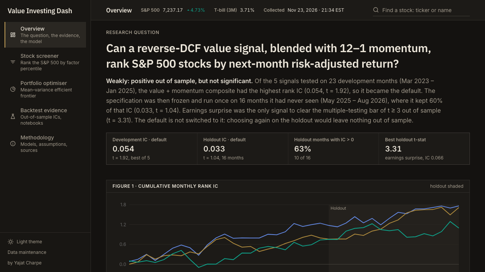
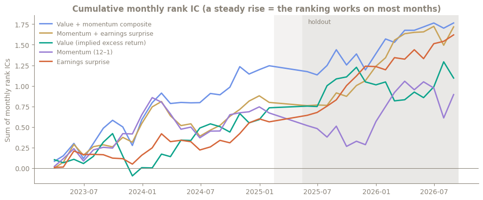
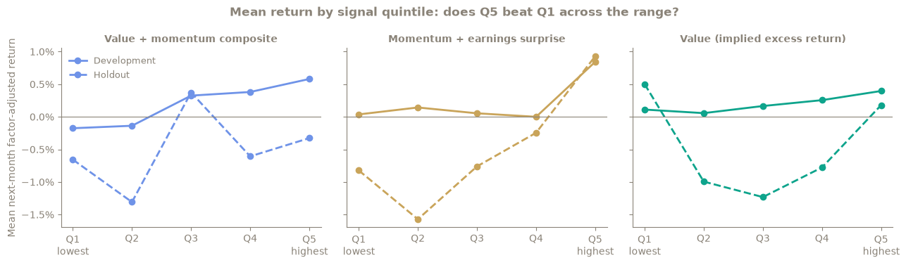
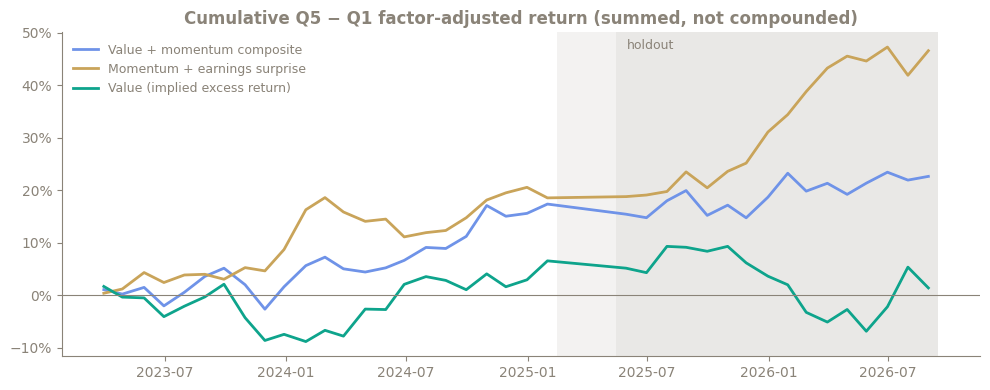
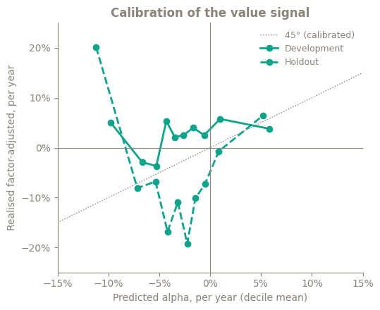
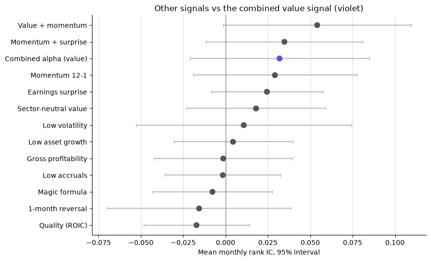
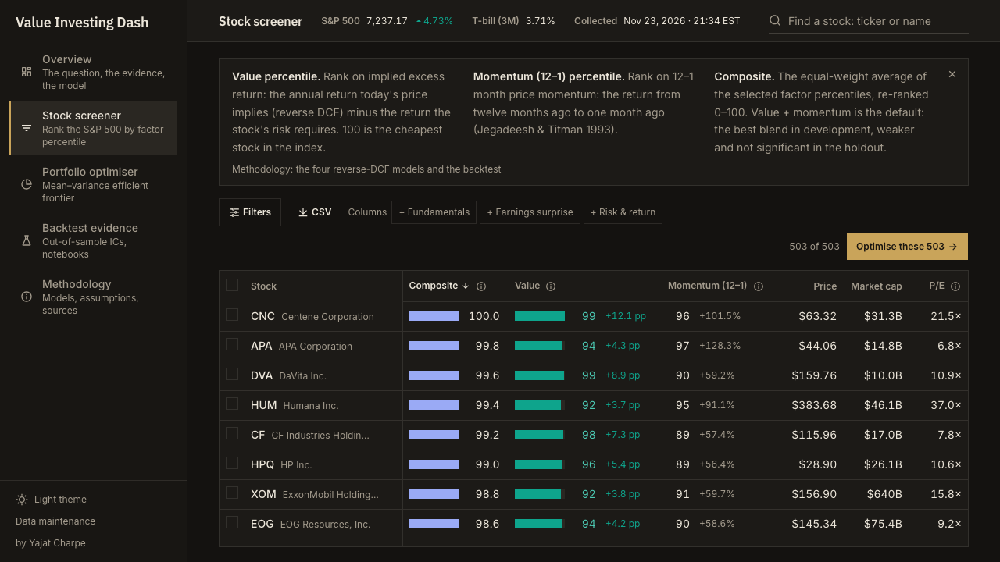
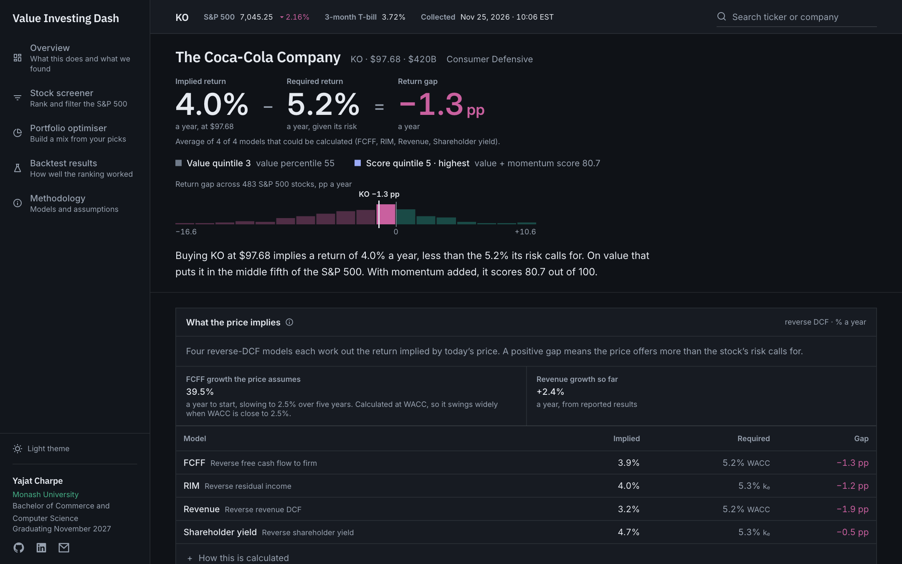
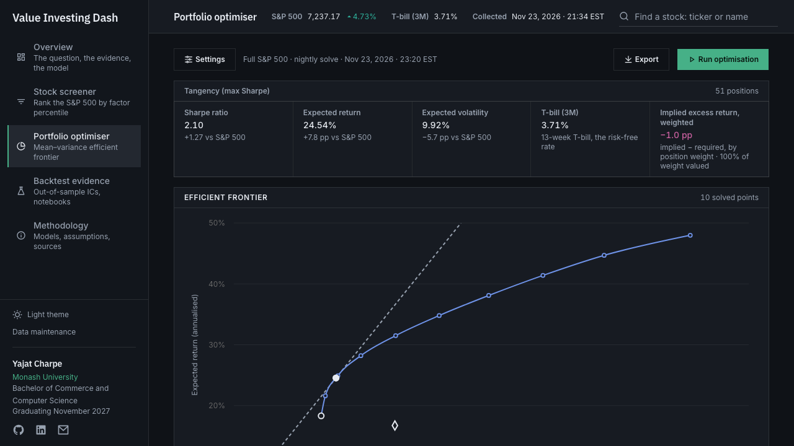
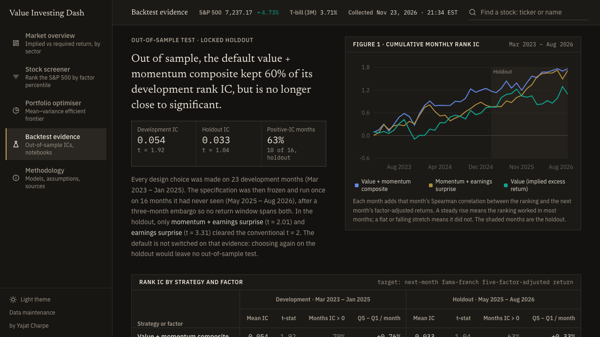

<div align="center">

# Value Investing Dash

**For every S&P 500 stock: what return does today’s price imply, and is that enough for the risk?**

Reverse-DCF valuation, a stock ranking with its test results published beside it, and a portfolio optimiser.


**[Open the live site](https://value-investing-dash.vercel.app)**

</div>



## Why it is useful

A standard DCF asks you to choose a discount rate and hands back a fair value. Small changes to that rate move the answer a long way. This dashboard runs the calculation backwards: it takes the market price as given and solves for the annual return that price implies. A return is easy to sanity-check, easy to compare across companies, and can be set directly against what the stock’s risk requires.

From there it does four jobs:

| Question | What you get |
|---|---|
| **What is the market assuming about this company?** | An implied return from four models, the required return beside it, and the free cash flow growth the price needs, next to the growth the company has delivered |
| **Where should I look first?** | All ~500 index members ranked and filterable by value, momentum and earnings surprise |
| **How much should I trust that ranking?** | The test results, including the weak ones, shown next to the ranking itself |
| **What would a portfolio of these look like?** | An efficient frontier over your picks, with sector exposure and each holding’s share of risk |

The third row is the one most screeners skip. Every strategy here carries its record on data kept back from its design, so you can see which parts have support and which do not.

## What the testing found

### How the test was set up

- **Target:** next month’s return after removing what the five Fama-French factors would explain. A signal that only repeats known factor exposure scores zero.
- **Measure:** rank IC, the correlation between this month’s ranking and the order of next month’s returns. 0 is chance.
- **Design period:** 23 months, Mar 2023 - Jan 2025. Every choice was made here.
- **Gap:** Feb - Apr 2025 is skipped so no return window overlaps both sides.
- **Unseen test (holdout):** 16 months, May 2025 - Aug 2026. The rules were frozen first, then run once.
- **Timing:** company accounts are only used from 60 days after the fiscal year ends.

The holdout is historical data that was set aside, not a live forward record. The warehouse now archives each day’s signal, so a forward record is accumulating.

### Results

| Signal | Design IC (t) | Unseen test IC (t) | Test months with IC > 0 | Test top fifth − bottom fifth, per month (t) |
|---|---|---|---|---|
| **Value + momentum** (default) | 0.054 (1.92) | 0.033 (1.04) | 63% | +0.33% (0.48) |
| Momentum + earnings surprise | 0.035 (1.47) | 0.057 (2.01) | 75% | +1.75% (2.33) |
| Value | 0.032 (1.18) | 0.023 (0.61) | 63% | −0.32% (−0.36) |
| Momentum (12-1) | 0.029 (1.18) | 0.014 (0.30) | 50% | +1.09% (0.87) |
| Earnings surprise | 0.024 (1.45) | 0.066 (3.31) | 75% | +1.62% (2.67) |

A t-stat of about 2 is the usual bar for ruling out luck. Harvey, Liu and Zhu (2016) argue for 3 once many signals have been tried.



*A line that keeps climbing means the ranking kept pointing the right way. From the [evidence notebook](python-api/notebooks/evidence.ipynb), where “holdout” is the unseen test.*

**What holds up**

- All five signals kept a positive rank IC on data they had never seen.
- Earnings surprise cleared the stricter t = 3 bar in the test, and momentum + earnings surprise cleared t = 2. Both are available in the screener.
- Each reverse-DCF model scored a higher rank IC than the plain ratio built from the same figures, in all six comparisons on design data. None of those gaps is statistically significant.

**What does not**

- The default, value + momentum, kept about 60% of its strength and is **not statistically significant**. It stays the default because it was chosen before the test. Switching to the winner afterwards would leave nothing tested on unseen data.
- The size of the return gap is **not a forecast**. The calibration slope (1 would be perfect) was 0.17 in design and −0.44 in the test. The site ranks on the gap and never presents it as expected return.
- Value on its own lost 0.7% a month as a raw buy-cheap, sell-expensive portfolio in the design period. Against the Fama-French factors its alpha was −4.3% a year (t = −0.76).



*Solid lines are the design period and dashed lines the unseen test. Only momentum + earnings surprise comes close to rising step by step in the test.*



*Summed monthly spreads in factor-adjusted return. This measures how well a signal separates stocks and is not a tradable return.*



*Why the site shows percentiles. If the gap forecast returns, these points would sit on the dotted line.*

### What else was tried

The [development notebook](python-api/notebooks/backtest.ipynb) tested the value signal against well-known alternatives before settling the design. Quality (ROIC), gross profitability, accruals, low volatility, short-term reversal and Greenblatt’s magic formula were flat or negative over this window.



*Design period only. Every interval crosses zero, which is the honest picture of 23 months of data.*

## A tour of the site

### Stock screener



Ranks the index on the combined score. Four strategies are built in (value + momentum, cheapest fifth on value, momentum + earnings surprise, and a partial Graham defensive screen), with filters for sector, quintile and beta. You can add fundamentals, earnings surprise and risk columns, export to CSV, and send the survivors to the optimiser.

### Stock page



Leads with one equation: implied return, less required return, equals the gap. Below it are each model’s result, the reason when a model cannot be calculated, multiples against sector peers, the percentile breakdown, a year of prices and the full required-return build-up.

### Portfolio optimiser



Solves the efficient frontier over the full index or your screened set, with position limits, short selling and L2 regularisation. It shows sector exposure, weight against share of risk, and the weighted return gap of the holdings. The Sharpe ratios are **in-sample**, fitted to three years of past prices, and should not be read as expected performance.

### Backtest results and methodology



Backtest results holds the verdict, the full table, quintile returns, calibration and both notebooks. Methodology explains each model, lists every assumption with where it comes from, states what the evidence does not show, and has a glossary.

## How the ranking is built

### Four reverse-DCF models

| Model | Cash flow it discounts | Must beat |
|---|---|---|
| **FCFF** | Free cash flow to the firm, against enterprise value | WACC |
| **Residual income** | Book value plus earnings above it, with ROE fading to the sector median | Cost of equity |
| **Revenue** | Revenue at a cash margin fading to the sector median, so temporarily cash-negative firms can be valued | WACC |
| **Shareholder yield** | Dividends plus net buybacks, against market cap | Cost of equity |

Each projects five years of cash flow fading to long-run growth, then a terminal value, and solves for the rate that equals today’s price. The **return gap** is that implied return minus the required return, averaged over the models that work for the company.

- **Cost of equity** is CAPM on the 10-year Treasury yield, with beta adjusted toward the average (Vasicek, then Levi-Welch).
- **Cost of debt** adds the spread for a synthetic credit rating from Damodaran’s table.
- **Financial firms** get no WACC, so only the two equity models apply to them.
- **Missing inputs** produce no figure. Nothing is filled in with a guess.

### Score

| Ingredient | Definition |
|---|---|
| **Value** | Percentile of the return gap |
| **Momentum** | Return from 12 months to 1 month ago (Jegadeesh & Titman 1993) |
| **Earnings surprise** | Latest EPS beat or miss against consensus, divided by price (Livnat & Mendenhall 2006) |

The default score is the equal-weight average of the value and momentum percentiles, re-ranked from 0 to 100.

### Why not fair values

An earlier version ran five forward models and screened on margin of safety. A fair value is a multiple levered by 1/(k − g), so one unusual year of cash flow or a low cost of equity sent margins past +700%, while the residual income model called the median stock 66% overvalued. The backtest found the size of those margins meaningless, and the models were removed.

## Engineering


| Layer | What it does |
|---|---|
| **Website** | Next.js 16, React 19, TypeScript and Tailwind on Vercel. Reads the database’s read-only views directly, so the screener and stock pages work with the Python service scaled to zero |
| **Data service** | FastAPI on Google Cloud Run. Loads prices and statements from yfinance and factor returns from the Ken French library, and runs the optimiser (PyPortfolioOpt, cvxpy, Clarabel) |
| **Database** | Supabase Postgres as a small ELT warehouse. `raw` holds provider rows as fetched, `warehouse` computes every ratio, beta, implied return and ranking in SQL, and `public` exposes read-only views |

The browser never learns the data service’s address, write routes require a token, and optimisation requests are rate limited per caller.

### Decisions worth explaining

**Python loads, Postgres calculates.** The Python service only brings in provider rows. `warehouse.refresh()` rebuilds everything in SQL, including the reverse-DCF root solve as a PL/pgSQL bisection, and archives that day’s signal in `warehouse.signal_history`.

**The max Sharpe portfolio is searched for.** Solving for it directly fails when no allowed portfolio beats the risk-free rate, which is common with value screens. Instead the frontier is traced as minimum-variance solves and the tangency is found along it with a ternary search. See [`frontier.py`](python-api/frontier.py).

**Impossible constraints are caught early.** A 10% position cap needs at least 10 stocks. Bounds are checked before solving, and the error says what cap would work.

**Estimates are steadied.** Ledoit-Wolf covariance, Bayes-Stein expected returns (Jorion 1986), and stocks with under 90% of the price history are left out.

**Screened sets fit in a URL.** A list of 500 tickers overflows request headers, so a set is encoded as one bit per index member. See [`ticker-set.ts`](lib/ticker-set.ts).

### Scheduled jobs

| Job | When (Toronto) | What |
|---|---|---|
| `margin-daily` | 18:30, Mon-Fri | Prices and factor returns, then a warehouse refresh |
| `margin-weekly` | 07:00, Saturday | The above plus statements, share counts, earnings dates and profiles |
| `margin-warm` | Every 5 minutes, 09:00-20:00 | Keeps one service instance warm |

## Limitations

- **Short history.** 23 design months and 16 test months cannot settle whether a signal works.
- **Survivorship bias.** The backtest uses today’s index members, which flatters the results.
- **One market regime.** 2023-2026 was led by very large growth companies, a poor stretch for value.
- **Data quality.** yfinance is unofficial, has gaps, and shows restated figures for older years. One unusual year can produce an extreme model result for a single company, so check the inputs on its stock page.
- **Past returns in the optimiser.** Its expected returns come from history, even after shrinkage.

This is a demonstration project and nothing in it is investment advice.

## Running it locally

**Prerequisites:** Node 20+, pnpm, Python 3.12, Docker and the Supabase CLI.

```bash
# Website
pnpm install
cp .env.example .env.local        # Supabase URL and publishable key, ENABLE_DATA_PAGE, BACKFILL_TOKEN

# Data service
cd python-api
python -m venv .venv
source .venv/bin/activate         # .venv\Scripts\activate on Windows
pip install -r requirements.txt
cp .env.example .env              # DATABASE_URL and the same BACKFILL_TOKEN
cd ..

# Database
supabase start -x storage-api,imgproxy,vector,logflare
supabase migration up --local
```

Then run each of these in its own terminal:

```bash
pnpm dev                                                   # localhost:3000
cd python-api && uvicorn main:app --reload --port 8000     # localhost:8000
```

With `ENABLE_DATA_PAGE=true`, open [localhost:3000/data](http://localhost:3000/data) and choose **Refresh everything**. The first load takes about 10 minutes. With no Supabase variables set, the site shows a labelled sample instead.

The same refresh from a terminal:

```bash
# Prices and factors
curl -X POST -H "X-Backfill-Token: $BACKFILL_TOKEN" "http://127.0.0.1:8000/backfill/all?skip_fundamentals=true"

# Everything, including statements
curl -X POST -H "X-Backfill-Token: $BACKFILL_TOKEN" "http://127.0.0.1:8000/backfill/all"
```

### Backtest

The published figures live in [`evidence.json`](app/research/_data/evidence.json), written by the evidence notebook. The method is documented in [`backtests.md`](python-api/notebooks/backtests.md). Rerunning it needs `requirements-dev.txt`, a local data pull (`python -m backtest.load`) and [`DWimplementation_v2.sql`](python-api/notebooks/DWimplementation_v2.sql). A fresh pull can give different numbers because the data provider revises history. After rerunning, `python notebooks/export_site.py` updates the site.

### Tests

```bash
pnpm lint && pnpm exec tsc --noEmit && pnpm test
cd python-api && python -m pytest tests backtest -q        # needs pytest; database tests skip without one
```

## Project layout

```
app/                    pages and server routes
components/             charts, tables, filters
lib/                    ranking, valuation types, formatting, URL encoding
python-api/             data service
  pipeline.py           scheduled stages, in order
  ingest.py             extract and load
  frontier.py           portfolio optimisation
  notebooks/            backtest, evidence and method
  backtest/             backtest data loader and model scripts
supabase/migrations/    raw, warehouse and public schemas
docs/                   deployment runbook and design notes
```

<details>
<summary><b>Data service endpoints</b></summary>

<br>

| Endpoint | What |
|---|---|
| `GET /health` | Liveness check |
| `POST /efficient-frontier` | Solve the frontier |
| `POST /backfill/all` | Every stage, then a warehouse refresh |
| `POST /backfill/prices` | Daily bars, dividends and splits |
| `POST /backfill/factor-returns` | Fama-French factors |
| `POST /backfill/fundamentals` | Statements, share counts, earnings dates, profiles |
| `POST /backfill/refresh` | Rebuild the warehouse and the default frontier |

Backfill routes need an `X-Backfill-Token` header.

```
POST /efficient-frontier
  ?tickers=AAPL,MSFT,…     omit for the whole index
  &short_allowed=false
  &n_portfolios=100        each point is a separate solve
  &min_weight=-0.05        fraction, omit for the default
  &max_weight=0.15         fraction, omit to scale to the set
  &gamma=1                 L2 penalty
```

</details>

## Deployment

- **Website → Vercel.** Set `MARKET_DATA_API_URL`, the Supabase URL and publishable key, and `MARGIN_ORIGIN_SECRET`.
- **Data service → Google Cloud Run** from [`python-api/Dockerfile`](python-api/Dockerfile). Set `DATABASE_URL`, `ALLOWED_ORIGINS`, `BACKFILL_TOKEN` and `MARGIN_ORIGIN_SECRET`. The database connection string never goes to Vercel.
- **Database → Supabase.** `supabase db push` applies the migrations.

More detail, including the scheduled jobs, is in [the deployment runbook](docs/deploy-runbook.md).

## Licence

[MIT](LICENSE)
