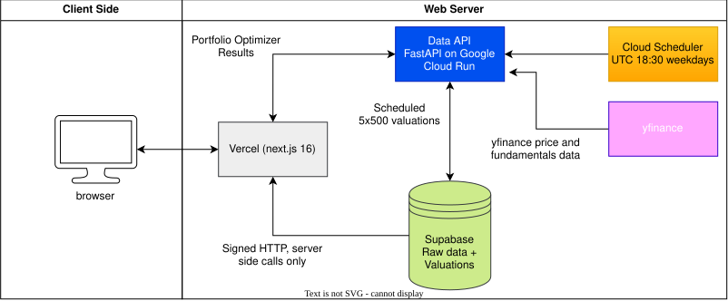

<div align="center">

# Value Investing Dash

**What return does each S&P 500 stock’s price imply, and is it more than its risk requires? Rank the index on that, confirm it with trend, then build an optimised portfolio from the screen.**

Next.js frontend | FastAPI Data API | Supabase PostgreSQL database


**Live demo - [https://value-investing-dash.vercel.app](https://value-investing-dash.vercel.app)**

</div>


## About

Based on Benjamin Graham’s principle of value investing, Value Investing Dash (VID) analyses stocks based on their fundamental value rather than just their historical returns. VID ranks the ~500 stocks in the S&P 500 on a signal that was tested against later returns (reverse-DCF value, momentum and earnings surprise), shows the return each price implies over the return its risk requires, lets the user screen on both, then builds an optimized portfolio out of whatever is left.

The reason for screening first is that a portfolio optimizer estimates expected return from past returns. A stock that has already run up looks like a great opportunity to the optimizer at exactly the point its price is most optimistic. Putting a valuation screen in front of the optimizer removes those stocks before it ever sees them.

## How it works

| | Page | What it does |
|---|---|---|
| | **Overview** | Is the market cheap? The median implied vs required return, sectors ranked by value, and the top ten on the default screen. |
| **1** | **Screener** | Rank the index on value + trend (or start from Deep value, Earnings momentum or a partial Graham screen), filter by sector and fifths, and add classic-ratio, trend and risk columns. Stocks that pass or are ticked go to the portfolio page. |
| **2** | **Stock** | A one-sentence verdict, the four implied returns and the growth the price assumes, classic ratios against the sector, trend and earnings, the price chart, and the required-return inputs. Reached from the search bar on every page. |
| **3** | **Portfolio** | Solve the efficient frontier over the screened stocks, setting position bounds, short selling and L2 regularisation, and see the portfolio’s value tilt. |
| | **Methodology** | Why reverse DCF, the backtest tables, every assumption with its source, and a glossary. |


## Infrastructure



**Frontend:** Next.js 16, React 19, TypeScript and Tailwind, deployed on Vercel. The screener and stock pages read the warehouse’s serving views straight from Supabase, so they render with the Data API scaled to zero.

**Data API:** A Python API on Google Cloud Run using FastAPI, cvxpy, Clarabel and NumPy. It extracts prices and fundamentals from yfinance and factor returns from the Ken French data library, loads them untouched, and runs the portfolio optimizer. A task scheduler runs the pipeline at market close.

**Database:** Supabase PostgreSQL as a small ELT warehouse. `raw` holds provider rows exactly as fetched; `warehouse` turns them into everything the site shows in SQL (statement pivots, betas, the reverse-DCF implied returns, the signal) and archives each day’s signal; `public` is the API, three read-only views the browser-safe key can read.

The frontend and the Data API talk over HTTP and deploy separately. The browser never learns the Data API address since requests are signed server-side, backfill routes are closed behind a token, and solves are rate limited per caller.

**Scheduled jobs** (Cloud Scheduler, Toronto time):

| Job | When | What |
|---|---|---|
| `margin-daily` | 18:30 Mon-Fri | Prices and factor returns, then a warehouse refresh after market close |
| `margin-weekly` | 07:00 Sat | Everything above plus statements, share counts, earnings dates and company profiles |
| `margin-warm` | Every 5 min, 09:00–20:00 | Pings `/health` so a GCloud Run instance is warm when a user runs an optimization |

## The signal

The [backtest](python-api/notebooks/backtests.md) tested each model against the next month’s factor-adjusted return over 23 development months. Three components ranked stocks better than the classic fair-value models (which were then removed, see below), and the screener ranks on them:

| Component | What it is | Development IC |
|---|---|---|
| **Value** | Reverse DCF: the return today’s price implies, minus the return the stock’s risk requires, averaged over reverse FCFF, residual income, revenue and shareholder-yield models | 0.032 |
| **Trend** | 12-1 momentum: the return from 12 months to 1 month ago (Jegadeesh & Titman 1993) | 0.029 |
| **Earnings** | Latest EPS beat or miss against the analyst consensus, scaled by price (Livnat & Mendenhall 2006) | 0.024 |
| *Value + trend* | The default blend, equal-weighted (Asness, Moskowitz & Pedersen 2013) | *0.054* |
| *Trend + earnings* | | *0.035* |

Each is shown as a percentile of today’s universe, and the score is the mean of the selected percentiles, re-ranked so its fifths hold equal numbers of stocks. The backtest found the size of expected alpha meaningless, so no component is shown as a return forecast. None of these results is statistically significant on 23 months yet, and the locked holdout hasn’t been run; the screener says so beside the controls.

## Valuation models

Value is read as a return, not a price. Each model solves for the annual return that makes a company’s cash flows worth today’s price, and the screener shows that return minus the return the stock’s risk requires:

| Model | Cash flow | Must beat |
|---|---|---|
| **FCFF** | Free cash flow to the firm, against enterprise value | WACC |
| **RIM** | Book value plus earnings above it, ROE fading to the sector median; works for banks | CAPM kₑ |
| **Revenue** | Revenue × a cash margin fading to the sector median; speaks for temporarily cash-negative firms | WACC |
| **Shareholder yield** | Dividends plus net buybacks, against market cap | CAPM kₑ |

Each grows its cash flow along a five-year fade to long-run growth, then a perpetuity, and the solve is a PL/pgSQL bisection. A model that has no positive cash flow to discount reports nothing. A stock’s reading averages whichever selected models solved, the rule the backtest tested; kₑ is CAPM off the 10-year Treasury yield with a Levi-Welch shrunk beta, and the cost of debt comes from Damodaran’s synthetic rating table. Every constant and its source is listed on the Methodology page and in `warehouse.spec`.

### Why not fair values

VID used to run five forward models (DDM, FCFE, FCFF, RIM, comps) and screen on a confidence-weighted consensus margin of safety. A fair value is the price times a multiple levered by 1/(k − g), so a lumpy cash-flow year or a low cost of equity sent margins past +700% while RIM called the median stock 66% overvalued, and the backtest found the margins’ size meaningless. They were removed in `20261117000003_drop_forward_models.sql`. Implied returns come from the same cash flows but stay in a range you can sanity check (median about 6% a year).

### Valuation is relative

Value is shown as a percentile (100 = cheapest), cut into fifths recomputed from the live cross-section at every refresh, as in a Fama-French sort. “Cheapest fifth” means exactly that, not that a stock will beat its required return by the number shown. The classic ratios (P/E, P/B, EV/EBITDA, FCF and shareholder yield, ROE) appear as context: in the backtest each lost to the reverse-DCF model built on the same figures.

## Decisions worth explaining

**Python extracts, Postgres transforms.** The Data API used to pivot statements, roll up trailing twelve months, run every model and assemble a JSON payload for the screener, after a minute of bulk reads through the REST API. Now it only loads provider rows, and `warehouse.refresh()` rebuilds everything in SQL in about four seconds, including the reverse-DCF root solve (a PL/pgSQL bisection). Every run archives that day’s signal in `warehouse.signal_history`, which builds a forward track record. The live signal SQL was checked against the backtest notebook stock by stock.

**The max Sharpe portfolio is found, not solved for.** Solving for max Sharpe directly has no solution whenever no allowed portfolio beats the risk-free rate, which happens a lot with value screens since they pick stocks with weak past returns. Instead the frontier is traced as a set of minimum variance solves and the tangency portfolio is found along it with a ternary search. If nothing beats cash, the best Sharpe is just negative instead of an error. See [`python-api/frontier.py`](python-api/frontier.py).

**Bad constraints get caught before the solver.** A 10% max position means at least 10 stocks are needed for the weights to add up to 100%, but the screener can hand over 5. Bounds are checked before any solve and the error tells you the minimum cap that would work, rather than showing a vague solver failure. The default cap is the UCITS 10% single-issuer limit, lifted for sets under 10 stocks.

**Screened sets fit in a short URL.** Passing ~500 tickers as `?tickers=A,AAPL,…` made a URL big enough to hit `431 Request Header Fields Too Large`. Since every screened set is a subset of the same index, it’s encoded as one bit per stock, which is 84 characters no matter how many stocks are selected. See [`lib/ticker-set.ts`](lib/ticker-set.ts).

**Estimates are kept in check.** Over three years of dividend-adjusted prices, covariance uses Ledoit-Wolf shrinkage, expected returns are Bayes-Stein shrunk toward the minimum-variance portfolio (Jorion 1986), and stocks with less than 90% of the price history (e.g. recent spin-offs) are left out rather than guessed.

## Running it locally

**Prerequisites:** Node 20+, pnpm, Python 3.12 and a free [Supabase](https://supabase.com) project.

```bash
# 1. Frontend
pnpm install
cp .env.example .env.local        # Supabase URL + publishable key, ENABLE_DATA_PAGE=true, BACKFILL_TOKEN

# 2. Data API
cd python-api
python -m venv .venv
source .venv/bin/activate         # .venv\Scripts\activate on Windows
pip install -r requirements.txt
cp .env.example .env              # Supabase URL + service role key, the same BACKFILL_TOKEN

# 3. Database (local)
supabase start -x storage-api,imgproxy,vector,logflare
supabase migration up --local     # applies supabase/migrations/
```

Run both:

```bash
pnpm dev                                                 # frontend → localhost:3000
cd python-api && uvicorn main:app --reload --port 8000   # Data API → localhost:8000
```

Open [localhost:3000/data](http://localhost:3000/data) and hit **Refresh everything** to run every stage in order and refresh the warehouse last, which takes about 10 minutes the first time.

The same backfills can be run from the terminal:

```bash
#Daily: prices, factors, warehouse refresh (~2 min)
curl -X POST -H "X-Backfill-Token: $BACKFILL_TOKEN" "http://127.0.0.1:8000/backfill/all?skip_fundamentals=true"

#Everything including statements (~10 min)
curl -X POST -H "X-Backfill-Token: $BACKFILL_TOKEN" "http://127.0.0.1:8000/backfill/all"
```

Every write is an upsert and prices are fetched from each ticker’s own newest stored date, so re-running is safe and cheap.

## Testing

```bash
pnpm lint && pnpm build
node --test lib/rank.test.ts     # percentile and quintile maths
```

## Project layout

```
app/                    Next.js pages
  api/                  server-side routes that forward to the Data API
components/             charts, tables, filters
lib/                    valuation types, URL encoding, formatting
python-api/             FastAPI Data API
  main.py               routes only
  pipeline.py           the scheduled stages, in order
  ingest.py             extract and load into the raw schema
  dw.py                 direct Postgres: bulk upserts, warehouse refresh
  frontier.py           portfolio optimization
  market.py             price and cash-rate reads
  notebooks/            the backtest and its plan (backtests.md)
  backtest/ml/          model scripts over the backtest export
supabase/migrations/    raw, warehouse and public schemas
docs/                   deployment runbook and design notes
```

<details>
<summary><b>Data API endpoints</b></summary>

<br>

| Endpoint | What |
|---|---|
| `GET /health` | Liveness check |
| `GET /returns/{ticker}` | Daily log returns and the risk-free rate |
| `POST /efficient-frontier` | Solve the frontier (see below) |
| `POST /backfill/all` | Every stage, in order, then the warehouse refresh |
| `POST /backfill/prices` | Daily bars, dividends and splits |
| `POST /backfill/factor-returns` | Fama-French factors |
| `POST /backfill/fundamentals` | Statements, share counts, earnings dates, profiles |
| `POST /backfill/refresh` | Rebuild the warehouse and the default frontier |

Backfill routes need an `X-Backfill-Token` header.

```
POST /efficient-frontier
  ?tickers=AAPL,MSFT,…     screened stocks, omit for the whole index
  &short_allowed=false
  &n_portfolios=100        each point is a separate solve
  &min_weight=-0.05        fraction not percent, omit for the default
  &max_weight=0.15         fraction not percent, omit to scale to the set
  &gamma=1                 L2 penalty
```

</details>

## Deployment

- **Frontend → Vercel.** Set `MARKET_DATA_API_URL`, the Supabase URL and publishable key, and `MARGIN_ORIGIN_SECRET`.
- **Data API → Google Cloud Run** from [`python-api/Dockerfile`](python-api/Dockerfile). Set `SUPABASE_URL`, `SUPABASE_SERVICE_ROLE_KEY`, `DATABASE_URL`, `ALLOWED_ORIGINS`, `BACKFILL_TOKEN` and `MARGIN_ORIGIN_SECRET`.
- **Database → Supabase.** `supabase db push` applies the migrations.

The service role key skips row-level security, so it only ever lives in the Data API and never on Vercel. The full walkthrough including the scheduled jobs is in [`docs/deploy-runbook.md`](docs/deploy-runbook.md).

## Limitations

- Prices and fundamentals come from yfinance, an unofficial source with major gaps as evident in the uneven coverage of the reverse-DCF models.
- Expected returns come from past returns, which are not reliable forecasts. The value screen helps, but a strong run still looks good to the optimizer.
- Nothing on Value Investing Dash is investment advice. It’s a demonstrator project.

## Licence

MIT
