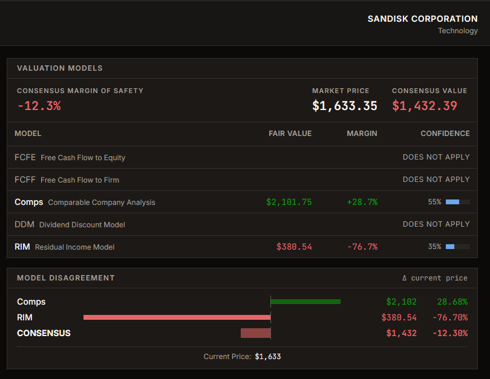

<div align="center">

# Value-Investing-Dash

**Value the S&P 500 using 5 valuation models, screen stocks out on their consensus fair value, then build an optimized portfolio on the rest.**

Next.js frontend | FastAPI Data API | Supabase PostgreSQL database


**Live demo - [https://value-investing-dash.vercel.app](https://value-investing-dash.vercel.app)**

</div>


## About

Based on Benjamin Graham’s principle of value investing, Value-Investing-Dash (VID) analyses stocks based on their fundamental value rather than just their historical returns. VID values the ~500 stocks in the S&P 500 with 5 different valuation models, combines them into a consensus fair value for each stock, lets the user screen stocks on that consensus, then builds an optimized portfolio out of whatever is left.

The reason for screening first is that a portfolio optimizer estimates expected return from past returns. A stock that has already run up looks like a great opportunity to the optimizer at exactly the point its price is most optimistic. Putting a valuation screen in front of the optimizer removes those stocks before it ever sees them.

## How it works

| | Page | What it does |
|---|---|---|
| **1** | **Screener** | Filter the index on consensus margin, valuation band, sector and what models value a stock as "underpriced", "overpriced", etc. Stocks that pass these filters or are selected go to the portfolio page. |
| **2** | **Analysis** | Each model’s fair value for one stock next to its price history, plus relevant discount rates the valuations used. |
| **3** | **Portfolio** | Solve the efficient frontier over the screened stocks, setting position bounds, short selling and L2 regularisation. |


## Infrastructure


**Frontend:** Next.js 16, React 19, TypeScript and Tailwind, deployed on Vercel. The screener and stock pages read precomputed valuation data from Supabase.

**Data API:** A Python API on Google Cloud Run using FastAPI, cvxpy, Clarabel and NumPy. Every valuation model, portfolio optimization and write to the database goes through it. Valuations and Prices & fundamentals come from yfinance and factor returns from the Ken French data library are backfilled at market close, UTC 18:30 by a task scheduler.

**Database:** Supabase PostgreSQL, storing raw prices, fundamentals and factor returns as well as the precomputed valuations.

The frontend and the Data API talk over HTTP and deploy separately. The browser never learns the Data API address since requests are signed server-side, backfill routes are closed behind a token, and solves are rate limited per caller.

**Scheduled jobs** (Cloud Scheduler, Toronto time):

| Job | When | What |
|---|---|---|
| `margin-daily` | 18:30 Mon-Fri | Prices, factor returns and recomputes valuation models for all stocks after market close |
| `margin-weekly` | 07:00 Sat | Everything above plus quarterly statements, company profiles and dividends |
| `margin-warm` | Every 5 min, 09:00–20:00 | Pings `/health` so a GCloud Run instance is warm when a user runs an optimization |

## Valuation models

| Model | Why it’s included |
|---|---|
| **DDM** | The most basic way to value a stock, based on receiving dividends growing into perpetuity. Only used for stocks yielding at least 1.5%. |
| **FCFE** | Values stocks that don’t pay dividends in a similar way to DDM, using the cash left over for shareholders. |
| **FCFF** | Uses the total cash from operations available to both debt and equity holders, so it handles firms with complex, changing or heavy debt. |
| **RIM** | Book value plus the profit a company makes above its cost of equity. Not very accurate, but it uses data the other models already pull so it has great coverage. |
| **COMPS** | Values a stock against the median EV/EBITDA and P/E of its sector, which captures market sentiment the other models miss. |

Every model is a pure function that returns nothing rather than a wrong number when its inputs don’t make sense, e.g. FCFE and FCFF skip banks and REITs since capex based cash flow doesn’t mean much for them. Coverage varies by stock, so the screener lets you set how many models have to value a stock before it gets rated (2 by default).



*COMPS picks up the market’s bullish view on flash memory demand in its valuation of SanDisk, while the other models call it overvalued.*

### Consensus margin

Each model’s margin is the difference between its fair value and the price. The consensus margin is the weighted average of those margins, where the weights are essentially a confidence in each model:

| Model | Base weight | Adjustments |
|---|---|---|
| FCFF | 0.80 | × 0.8 if the tax rate wasn’t available |
| FCFE | 0.75 | × 0.6 if net borrowing is more than half of FCFE |
| DDM | 0.60 | × payment stability (0–1), then × 0.6 if the payout ratio is above 0.9 |
| COMPS | 0.55 | none |
| RIM | 0.35 | × min(1, quarters used / 4) |

When FCFE and FCFF both value a stock, each is scaled by 1/√2, since they discount the same cash flows two different ways and would otherwise get two votes.

### Valuation is relative

The valuation bands (Deep value, Undervalued, Fair value, Overvalued, Expensive) each cover a fifth of the stocks ranked by consensus margin. So “Deep value” means the cheapest fifth of the index, not that a stock is below its intrinsic value.

## Decisions worth explaining

**Valuations are precomputed.** Calculating valuations for ~500 stocks on every request would make the screener slow to load for no reason, since prices, fundamentals and rates only change once a day. So they’re computed after each market close and stored per stock and model, and every run is also archived by market date in `valuation_history`, which builds a forward track record.

**The max Sharpe portfolio is found, not solved for.** Solving for max Sharpe directly has no solution whenever no allowed portfolio beats the risk-free rate, which happens a lot with value screens since they pick stocks with weak past returns. Instead the frontier is traced as a set of minimum variance solves and the tangency portfolio is found along it with a ternary search. If nothing beats cash, the best Sharpe is just negative instead of an error. See [`python-api/frontier.py`](python-api/frontier.py).

**Bad constraints get caught before the solver.** A 3% max position means at least 34 stocks are needed for the weights to add up to 100%, but the screener can hand over 5. Bounds are checked before any solve and the error tells you the minimum cap that would work, rather than showing a vague solver failure. By default the cap widens for small sets so a feasible portfolio always exists.

**Screened sets fit in a short URL.** Passing ~500 tickers as `?tickers=A,AAPL,…` made a URL big enough to hit `431 Request Header Fields Too Large`. Since every screened set is a subset of the same index, it’s encoded as one bit per stock, which is 84 characters no matter how many stocks are selected. See [`lib/ticker-set.ts`](lib/ticker-set.ts).

**Estimates are kept in check.** Covariance uses Ledoit-Wolf shrinkage, expected returns are clipped to ±50%, and stocks with less than 90% of the price history (e.g. recent spin-offs) are left out rather than guessed.

## Running it locally

**Prerequisites:** Node 20+, pnpm, Python 3.12 and a free [Supabase](https://supabase.com) project.

```bash
# 1. Frontend
pnpm install
cp .env.example .env.local        # Supabase URL + publishable key, ENABLE_DATA_PAGE=true, BACKFILL_TOKEN

# 2. Data API
cd python-api
python -m venv .venv
source .venv/bin/activate         # .venv\Scripts\activate on Windows
pip install -r requirements.txt
cp .env.example .env              # Supabase URL + service role key, the same BACKFILL_TOKEN

# 3. Database
supabase link --project-ref <your-ref>
supabase db push                  # applies supabase/migrations/
```

Run both:

```bash
pnpm dev                                                 # frontend → localhost:3000
cd python-api && uvicorn main:app --reload --port 8000   # Data API → localhost:8000
```

Open [localhost:3000/data](http://localhost:3000/data) and hit **Refresh everything** to run every backfill in order and recomputes the valuations last, which takes about 10 minutes the first time.

The same backfills can be run from the terminal:

```bash
#Daily: prices, factors, valuations (~2 min)
curl -X POST -H "X-Backfill-Token: $BACKFILL_TOKEN" "http://127.0.0.1:8000/backfill/all?skip_fundamentals=true"

#Everything including quarterly statements (~10 min)
curl -X POST -H "X-Backfill-Token: $BACKFILL_TOKEN" "http://127.0.0.1:8000/backfill/all"
```

Every backfill is incremental and every write is an upsert, so re-running is safe and only pulls unfilled rows in the last 252 day window.

## Testing

```bash
pnpm lint && pnpm build
```

## Project layout

```
app/                    Next.js pages
  api/                  server-side routes that forward to the Data API
components/             charts, tables, filters
lib/                    valuation types, URL encoding, formatting
python-api/             FastAPI Data API
  main.py               routes only
  valuation.py          the 5 models, as pure functions
  engine.py             runs every model across the index
  frontier.py           portfolio optimization
  backfill.py           data ingest, in order
  market.py             price and return reads
  universe.py           the scored stocks the screener uses
  db.py                 Supabase access
supabase/migrations/    schema and views
docs/                   deployment runbook and design notes
```

<details>
<summary><b>Data API endpoints</b></summary>

<br>

| Endpoint | What |
|---|---|
| `GET /health` | Liveness check |
| `GET /quote/{ticker}` | Latest price |
| `GET /info/{ticker}` | Full yfinance info |
| `GET /history/{ticker}` | Price history |
| `GET /returns/{ticker}` | Daily log returns and the risk-free rate |
| `GET /valuations` | Every model’s valuation of every stock |
| `POST /efficient-frontier` | Solve the frontier (see below) |
| `POST /backfill/all` | Every backfill, in order |
| `POST /backfill/sp500-daily-close` | Daily closes |
| `POST /backfill/factor-returns` | Fama-French factors |
| `POST /backfill/quarterly-fundamentals` | Statements, profiles, dividends |
| `POST /backfill/company-profile` | Profiles only |
| `POST /backfill/valuations` | Recompute every model |

Backfill routes need an `X-Backfill-Token` header.

```
POST /efficient-frontier
  ?tickers=AAPL,MSFT,…     screened stocks, omit for the whole index
  &short_allowed=false
  &n_portfolios=100        each point is a separate solve
  &min_weight=-0.05        fraction not percent, omit for the default
  &max_weight=0.15         fraction not percent, omit to scale to the set
  &gamma=1                 L2 penalty
```

</details>

## Deployment

- **Frontend → Vercel.** Set `MARKET_DATA_API_URL`, the Supabase URL and publishable key, and `MARGIN_ORIGIN_SECRET`.
- **Data API → Google Cloud Run** from [`python-api/Dockerfile`](python-api/Dockerfile). Set `SUPABASE_URL`, `SUPABASE_SERVICE_ROLE_KEY`, `ALLOWED_ORIGINS`, `BACKFILL_TOKEN` and `MARGIN_ORIGIN_SECRET`.
- **Database → Supabase.** `supabase db push` applies the migrations.

The service role key skips row-level security, so it only ever lives in the Data API and never on Vercel. The full walkthrough including the scheduled jobs is in [`docs/deploy-runbook.md`](docs/deploy-runbook.md).

## Limitations

- Prices and fundamentals come from yfinance, an unofficial source with major gaps as evident in the coverage of the FCFF and FCFE models.
- Expected returns come from past returns, which are not reliable forecasts. The value screen helps, but a strong run still looks good to the optimizer.
- Nothing on Value-Investing-Dash is investment advice. It’s a demonstrator project.

## Licence

MIT
